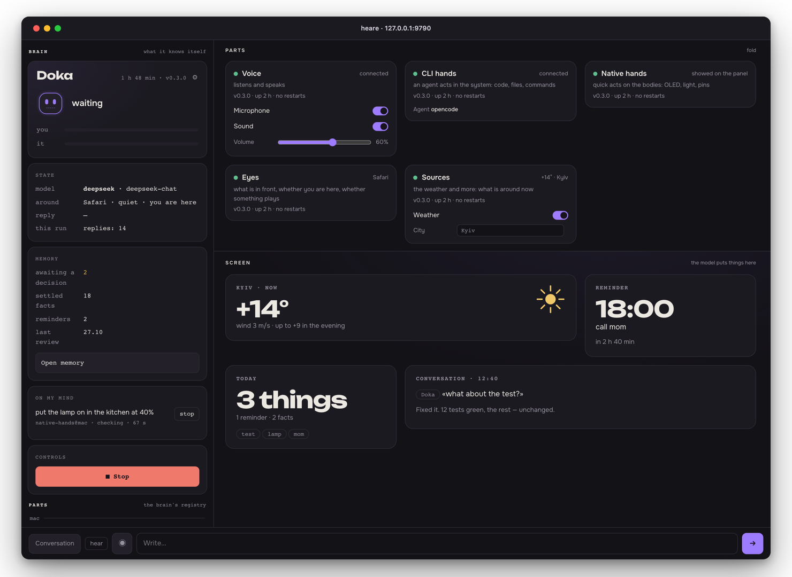
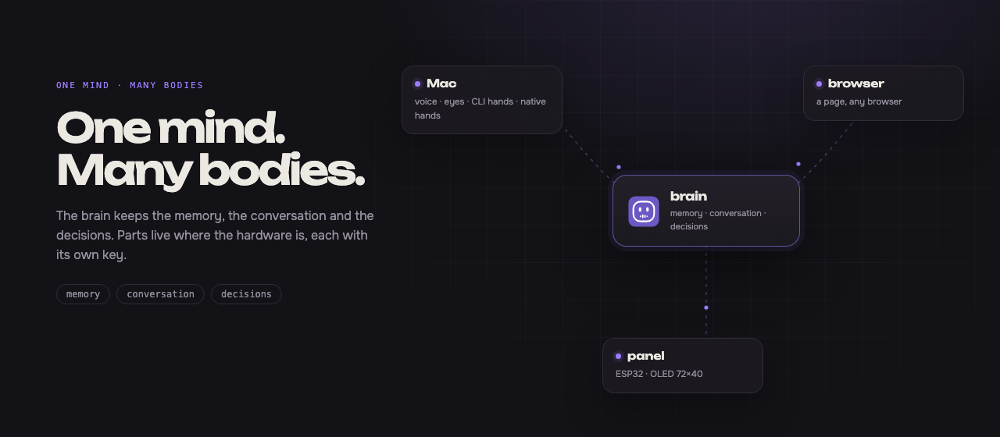

  

<h1 align="center">heare</h1>

  A voice assistant for the Mac that you talk to out loud. 
  It runs on your own computer, with your own keys.

  <b>English</b> · <a href="README.uk.md">Українська</a>

  <a href="https://github.com/onelenyk/heare/releases/latest">Download</a> ·
  <a href="docs/server.md">Server and Docker</a> ·
  <a href="docs/develop.md">Develop</a>

  
  
  
  

  

The pult, with sample data: state, parts, the canvas, the conversation.

---

## What it does

- **Listens, and decides for itself whether it is being spoken to.** No
  button, no "Hey, …". Want it stricter? Switch the voice to "only on its
  name".
- **Answers in a voice** — briefly, and it stops when you talk over it.
- **Does things while you talk**, with two kinds of hands:
  - **native hands** act on your own bodies at once: show something on a
    small OLED panel, switch a light, read a pin. A model with the parts'
    skills, a second or two, no agent;
  - **CLI hands** give the work to a coding agent on your Mac
    ([opencode](https://opencode.ai) or
    [Claude Code](https://docs.anthropic.com/en/docs/claude-code)): code,
    files, commands, web searches — and it tells you what came of them.

  Which hands get a piece of work is a rule, not a guess: work that goes on
  goes to the hands that did the last; everything else tries the native
  hands first, and they hand it on when it is not theirs.
- **Sees what is around.** Which app is in front, whether something is
  playing. A **Now** block can add a short line — the weather today — and
  it stays only while it is true.
- **Remembers.** Conversations, facts about you, reminders — in `~/.heare`
  on your Mac, not in someone else's cloud. Facts are pulled out of the
  talk on their own every few minutes.
- **Reaches past the Mac.** Every part is its own process and knocks with
  its own key; a page in any browser is a body too. Parts from other
  computers appear on the pult and wait until you let them in.

Its name is **Дока** (Doka). It speaks English by default; Ukrainian is one
switch away in ⚙.

  

One mind, many bodies. Each part is its own process with its own key.

## Install

1. Download the app from the
   [latest release](https://github.com/onelenyk/heare/releases/latest):
   `heare-arm64.dmg` for an Apple Silicon Mac (M1 and later),
   `heare-x86_64.dmg` for an Intel one.
2. Open it and drag heare to Applications.
3. Open heare. The app is not signed by Apple, so the first time macOS will
   refuse to open it. Either:
   - right-click heare in Applications → **Open** → **Open**, or
   - open **System Settings → Privacy & Security**, scroll to the message
     about heare and click **Open Anyway**.

   You only need to do this once.

## First run

heare opens its setup in its own window and asks for:

- **Parts** — what it may use here:
  - *Voice* — the microphone and the speaker;
  - *Eyes* — which app is in front, whether something plays;
  - *Sources* — what is around now: the weather;
  - *CLI hands* — the agent that does the work;
  - *Native hands* — quick acts on the bodies: a panel, a light, a pin.
- **Keys** — two:
  - **DeepSeek**, for thinking: <https://platform.deepseek.com/api_keys>
  - **Groq**, for hearing (speech to text): <https://console.groq.com/keys>

  A key is written once into the Keychain and never shown again.

**CLI hands** need a coding agent already installed and signed in:
[opencode](https://opencode.ai) or
[Claude Code](https://docs.anthropic.com/en/docs/claude-code). Without one,
heare still talks and the native hands still work; it just cannot do code,
files or commands for you.

## Using it

heare lives in the menu bar. Its face shows what it is doing:

| Face | State |
| --- | --- |
| head and eyes | waiting |
| taller eyes | listening |
| eyes up and aside | thinking |
| mouth moving like a wave | speaking |
| eyes closed | off |

In the menu:
- **Відкрити heare** (Open heare) — the pult: state, conversation, memory,
  parts;
- **Частини** (Parts) — turn voice, eyes, sources and hands on or off;
- **Налаштування…** (Settings…) — keys and model;
- **Запускати при вході** (Start at login);
- **Перевірити оновлення…** (Check for updates…);
- **Про heare** (About heare), **Видалити heare…** (Remove heare…),
  **Вийти** (Quit).

The pult shows the brain's version and uptime, and on every part card its
version, how long it has been up, how many times it restarted and its last
error. The conversation shows what the model looked up and the last steps
of a piece of work while it runs.

Parts from other computers appear on the pult and wait until you let them in.

## Update

When a new version is out, the pult shows a banner **Є heare 0.x.y · у тебе
0.x.y** with an **Оновити** button, and the menu shows **Є heare 0.x.y —
оновити…**; the menu also has **Перевірити оновлення…** (Check for
updates…). Click it and heare:
1. downloads the release and checks it against the release's sums;
2. backs up your memory;
3. puts the new app in place of the old one and starts again.

Conversations, keys and settings stay where they are.

macOS may ask for the microphone again: the app is unsigned, so to the
system every version is a new program.

## Back up and move to another Mac

On the pult: **Памʼять → Копії → Зробити копію** (Memory → Backups → Make a
backup). A backup is one file: conversations, journal, facts, profile,
reminders, settings and, if you leave the switch on, the voice recordings.
It does not hold the model keys or this Mac's pairings. Backups are kept in
`~/.heare/backups`; **Завантажити** (Download) saves one wherever you like.

On the new Mac: install heare, enter the keys, then **Принести копію…**
(Bring a backup…) and **Відновити** (Restore). What the backup replaced is
kept in `~/.heare/backups/before-restore-…`.

## Limits

- **From a phone, not yet.** The page works in a browser, but the
  microphone needs a secure context (https), and no tunnel or domain ships
  with heare. Until one does, a phone cannot be a body.
- **The agent cannot touch the bodies.** Native hands call the parts'
  skills; the coding agent gets no such tools yet. It can do code, files
  and commands, but cannot switch a light or write on the panel.
- **The brain can live elsewhere, but not be found from outside by itself.**
  It runs as a separate process, on a Linux machine or in Docker
  ([docs/server.md](docs/server.md)); parts pair with a token. There is no
  TLS and no public address out of the box, so a remote brain needs a
  tunnel or a proxy you set up yourself.
- **It is unsigned.** Every update is a new program to macOS, which asks
  for the microphone again.

## Uninstall

Choose **Видалити heare…** (Uninstall heare…) in heare's menu. It asks
whether to keep your memory:
- **keep** — conversations, facts, settings and backups stay in `~/.heare`,
  and installing heare again picks them up;
- **remove all** — memory too.

Either way heare stops, its keys leave the Keychain, start at login is
turned off, and everything removed goes to the Trash — nothing is deleted
outright. Files the agent made in `~/heare-work` stay.

From a terminal:
`/Applications/heare.app/Contents/MacOS/heare --uninstall keep-memory`
(or `all`).

## More

- [Server and Docker](docs/server.md) — the brain on an always-on Linux
  machine or in a container.
- [Develop](docs/develop.md) — build from source, tests, releases.
- [docs/laws.md](docs/laws.md) — the laws it works under.
- [docs/product/](docs/product/README.md) — the live plan (in Ukrainian).

The guides in `docs/` are in Ukrainian.

## License

heare is source-available under the
[PolyForm Shield License 1.0.0](LICENSE): you may read, run, change and
share it for any purpose except providing a product that competes with it.

The pult's fonts, [Onest](https://github.com/simpals/onest) and
[Unbounded](https://github.com/googlefonts/unbounded), ship with it under
the SIL Open Font License 1.1 (`packages/heare-brain/heare/api/fonts/`).
