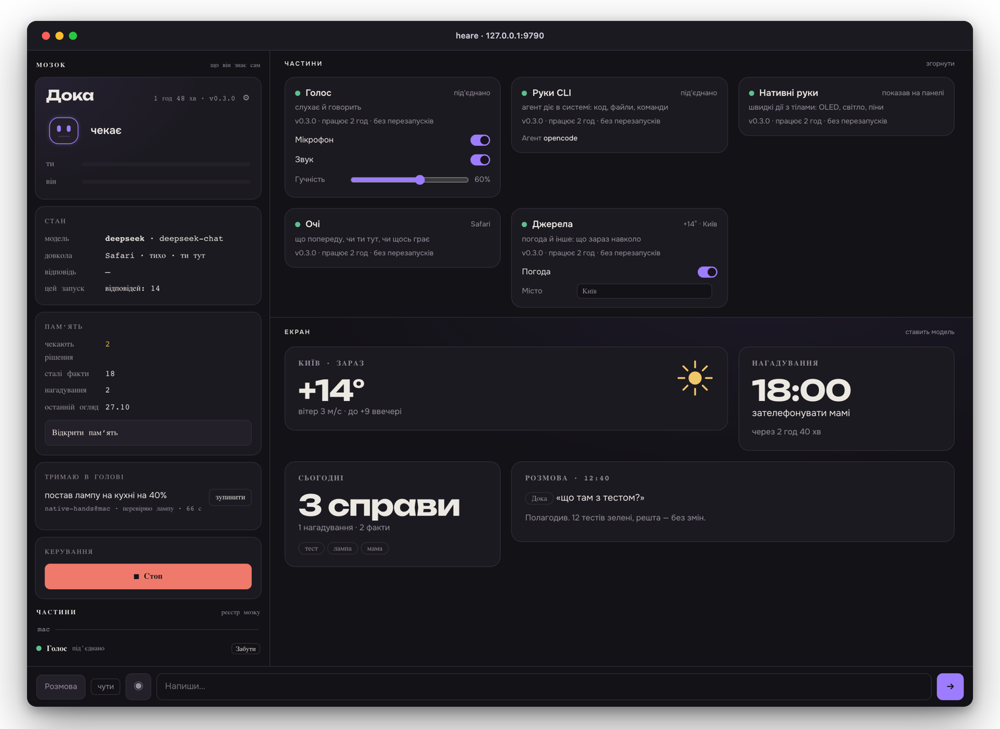
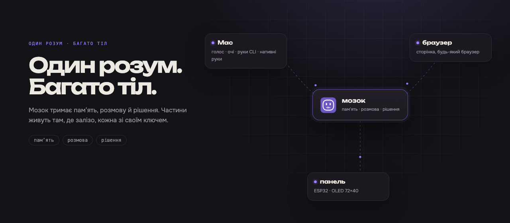

  

<h1 align="center">heare</h1>

  Голосовий помічник для мака, з яким говорять уголос. 
  Працює на твоєму комп'ютері, з твоїми ключами.

  <a href="README.md">English</a> · <b>Українська</b>

  <a href="https://github.com/onelenyk/heare/releases/latest">Завантажити</a> ·
  <a href="docs/server.md">Сервер і Docker</a> ·
  <a href="docs/develop.md">Розробка</a>

  
  
  
  

  

Пульт із демонстраційними даними: стан, частини, канвас, розмова.

---

## Що він уміє

- **Слухає й сам вирішує, чи звертаються до нього.** Не треба тиснути
  кнопку чи казати «Гей, …». Хочеш суворіше — перемкни голос на «лише на
  ім'я».
- **Відповідає голосом** — коротко, українською, і замовкає, коли
  перебиваєш.
- **Робить справи, поки ви говорите**, двома парами рук:
  - **нативні руки** діють одразу на твоїх тілах: показати щось на
    маленькому OLED-екрані, увімкнути світло, прочитати пін. Модель зі
    скілами частин, секунда-дві, без агента;
  - **руки CLI** віддають справу агентові-кодеру на твоєму маці
    ([opencode](https://opencode.ai) або
    [Claude Code](https://docs.anthropic.com/en/docs/claude-code)): код,
    файли, команди, пошук в інтернеті — і розповідають, що вийшло.

  Кому дістанеться справа — правило, а не здогад: продовження йде тим
  рукам, що робили попереднє; усе інше спершу пробують нативні руки, а
  не своє передають далі.
- **Бачить, що навколо.** Яка програма попереду, чи щось грає. Блок
  **«Зараз»** може додати короткий рядок — погоду сьогодні — і тримає
  його, поки він правдивий.
- **Пам'ятає.** Розмови, факти про тебе, нагадування — у теці `~/.heare`
  на твоєму маці, не в чужій хмарі. Факти витягуються з розмови самі
  кожні кілька хвилин.
- **Дотягується далі за мак.** Кожна частина — окремий процес, стукає зі
  своїм ключем; сторінка в будь-якому браузері — теж тіло. Частини з
  інших комп'ютерів з'являються на пульті й чекають, поки ти їх впустиш.

Його звати **Дока**. Говорить англійською типово; українська — одним
перемикачем у ⚙.

  

Один розум, багато тіл. Кожна частина — окремий процес зі своїм ключем.

## Встановити

1. Завантаж застосунок з
   [останнього релізу](https://github.com/onelenyk/heare/releases/latest):
   `heare-arm64.dmg` для мака на Apple Silicon (M1 і новіші),
   `heare-x86_64.dmg` для мака на Intel.
2. Відкрий його й перетягни heare в «Програми».
3. Відкрий heare. Застосунок не підписаний Apple, тож першого разу macOS
   відмовиться його відкрити. Зроби одне з двох:
   - клацни heare у «Програмах» правою кнопкою → **Відкрити** → **Відкрити**;
   - або **Системні параметри → Приватність і безпека**, прокрути до
     повідомлення про heare і натисни **Усе одно відкрити**.

   Це треба лише раз.

## Перший запуск

heare відкриє налаштування у власному вікні й попросить:

- **Частини** — що йому можна тут:
  - *Голос* — мікрофон і динамік;
  - *Очі* — яка програма попереду, чи щось грає;
  - *Джерела* — що зараз навколо: погода;
  - *Руки CLI* — агент, що робить справи;
  - *Нативні руки* — швидкі дії з тілами: панель, світло, пін.
- **Ключі** — два:
  - **DeepSeek**, щоб думати: <https://platform.deepseek.com/api_keys>
  - **Groq**, щоб чути (мову в текст): <https://console.groq.com/keys>

  Ключ записується один раз у Keychain і більше не показується.

Для **рук CLI** потрібен агент, уже встановлений і з входом:
[opencode](https://opencode.ai) або
[Claude Code](https://docs.anthropic.com/en/docs/claude-code). Без нього
heare все одно розмовляє і нативні руки працюють; лише не робить коду,
файлів і команд за тебе.

## Як ним користуватись

heare живе в рядку меню. Іконка-обличчя показує, що він робить:

| Обличчя | Стан |
| --- | --- |
| голова й очі | чекає |
| очі вищі | слухає |
| очі вгору-вбік | думає |
| рот рухається, як хвиля | говорить |
| очі заплющені | вимкнено |

У меню:
- **Відкрити heare** — пульт: стан, розмова, пам'ять, частини;
- **Частини** — увімкнути чи вимкнути голос, очі, джерела й руки;
- **Налаштування…** — ключі й модель;
- **Запускати при вході**;
- **Перевірити оновлення…**;
- **Про heare**, **Видалити heare…**, **Вийти**.

Пульт показує версію мозку й час роботи, а на картці кожної частини —
версію, час роботи, кількість перезапусків і останню помилку. Розмова
показує, що модель шукала, і останні кроки справи, поки вона йде.

Частини з інших комп'ютерів з'являються на пульті й чекають, поки ти їх
впустиш.

## Оновити

Коли виходить нова версія, на пульті з'являється банер **«Є heare 0.x.y ·
у тебе 0.x.y»** з кнопкою **Оновити**, а в меню — **«Є heare 0.x.y —
оновити…»**; у меню є й **«Перевірити оновлення…»**. Натисни, і heare сам:
1. завантажить реліз і звірить його контрольні суми;
2. зробить копію пам'яті;
3. поставить себе на місце старого й перезапуститься.

Розмови, ключі й налаштування лишаються на місці.

macOS може знову спитати дозвіл на мікрофон: застосунок не підписаний, тож
для системи кожна версія — нова програма.

## Копія й переїзд на інший мак

На пульті: **Пам'ять → Копії → Зробити копію**. Копія — один файл: розмови,
журнал, факти, профіль, нагадування, налаштування й, якщо лишиш перемикач,
записи голосу. Ключів моделей і спарювань цього мака в ній немає. Копії
лежать у `~/.heare/backups`; **Завантажити** збереже її куди скажеш.

На новому маку: встанови heare, введи ключі, далі **Принести копію…** і
**Відновити**. Те, що копія замінила, лишається в
`~/.heare/backups/before-restore-…`.

## Межі

- **З телефона — ще ні.** Сторінка працює в браузері, але мікрофону
  потрібен secure context (https), а тунелю чи домену heare не постачає.
  Поки що телефон не може бути тілом.
- **Агент не торкається тіл.** Нативні руки кличуть скіли частин; у
  агента-кодера таких інструментів ще немає. Він робить код, файли й
  команди, але не може увімкнути світло чи написати на панелі.
- **Мозок може жити деінде, але сам назовні не видно.** Він працює
  окремим процесом, на Linux-машині або в Docker
  ([docs/server.md](docs/server.md)); частини спарюються токеном. TLS і
  публічної адреси з коробки немає, тож віддаленому мозку потрібен тунель
  або проксі, який ти поставиш сам.
- **Він не підписаний.** Кожне оновлення для macOS — нова програма, яка
  знову спитає мікрофон.

## Видалити

У меню heare — **Видалити heare…**. Він спитає, чи лишити пам'ять:
- **лишити** — розмови, факти, налаштування й копії лишаються в `~/.heare`,
  і нова установка їх підхопить;
- **видалити все** — разом з пам'яттю.

В обох випадках heare зупиняється, його ключі виходять з Keychain, запуск
при вході вимикається, а все прибране йде в Кошик — нічого не стирається
одразу. Файли, які агент зробив у `~/heare-work`, лишаються.

З терміналу:
`/Applications/heare.app/Contents/MacOS/heare --uninstall keep-memory`
(або `all`).

## Ще

- [Сервер і Docker](docs/server.md) — мозок на Linux-машині, що завжди
  ввімкнена, або в контейнері.
- [Розробка](docs/develop.md) — зібрати з коду, тести, реліз.
- [docs/laws.md](docs/laws.md) — закони, за якими він працює.
- [docs/product/](docs/product/README.md) — живий план (українською).

Посібники в `docs/` — українською.

## Ліцензія

heare — код у відкритому доступі (source-available) за
[PolyForm Shield License 1.0.0](LICENSE): його можна читати, запускати,
змінювати й поширювати з будь-якою метою, крім продукту, що конкурує з
heare.

Шрифти пульта, [Onest](https://github.com/simpals/onest) і
[Unbounded](https://github.com/googlefonts/unbounded), ідуть разом з ним за
SIL Open Font License 1.1 (`packages/heare-brain/heare/api/fonts/`).
